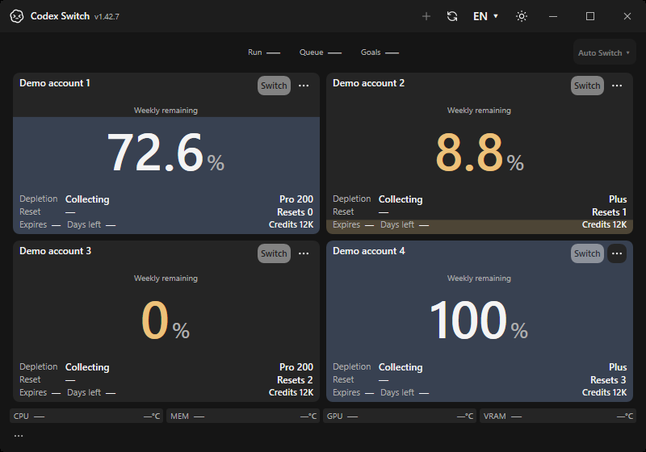
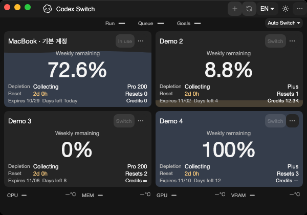

# Windows resource-report version

The actual `--verify-resources` command now records the loaded application assembly version instead of the historical1.19.0 literal. [Issue127](https://github.com/Gaebabi/codex-switch/issues/127) / [PR128](https://github.com/Gaebabi/codex-switch/pull/128).

The same issue corrects the equivalent historical literals in shared queue, Windows switch-protocol and Mac native reports. Actual queue/WAL checks require the declared version on each OS; native protocol/Mac receipts retain original diagnostic outcomes. Mac installed-client discovery can remain explicitly unavailable on hosted runners, distinct from metadata verification and complete native diagnostic acceptance.

| Original1.42.7 application | Corrected source, same dashboard |
| --- | --- |
|  |  |

These are original hosted own-WPF-window exports on Windows x64/.NET10.0.13 with fictional accounts. The dashboard has no intended visual change; its pictures do not display or prove the diagnostic JSON version. [Source, artifact and image hashes](evidence.json) distinguish the original baseline from the corrected capture. No personal pixels or image metadata are retained.

| Original Mac ARM64 / Intel | Corrected source, same native dashboard |
| --- | --- |
|  |  |
|  |  |

Both native Mac architectures use software rendering on hosted runners and fictional accounts. Their original pixels and source/runtime/hash scope are recorded above; these are not maintainer MacBook or installed-account acceptance.

The separate actual-command regression reproduced `expected1.42.7, observed1.19.0` on the unchanged installed app, then passed all three checks on the corrected self-contained application. An explicitly overridden local non-release build also reported9.87.6 correctly, demonstrating that the value follows the build rather than another release literal. This did not change the canonical product version or install that test build.

The [hosted command receipt](verification.json) compares the report against Directory.Build.props, requires supplied absent account/home directories to remain absent, and checks the original all-counter availability/exit-code contract against actual native samples. Unavailable GPU/VRAM may truthfully retain diagnostic exit1; metadata verification does not claim physical sensor support. Raw hardware samples are temporary and are not exported.

The [actual Windows protocol receipt](protocol-verification.json) requires the complete disposable protocol fixture to pass. [Mac ARM64](macos-arm64-verification.json) and [Mac Intel](macos-x64-verification.json) receipts verify the actual native diagnostic version, preserve the original exit status and explicitly retain any installed-client discovery failure on runners without Codex; every other native check must pass. Queue/WAL tests separately require the declared version for every successful and unavailable report, retaining database/WAL byte-preservation assertions on Windows, Mac and Linux.

The Windows required check now runs `python scripts/verify-resource-report.py <published-CodexSwitch.exe> --output <verification.json>`. All six protected final-head checks, author review and source/merge equality remain required for promotion. No owner account/client action, installed-app replacement or binary release is included.
