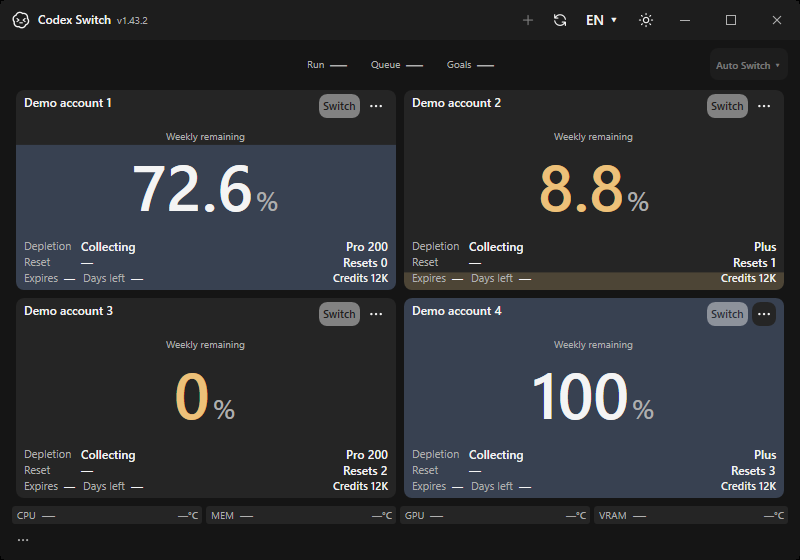
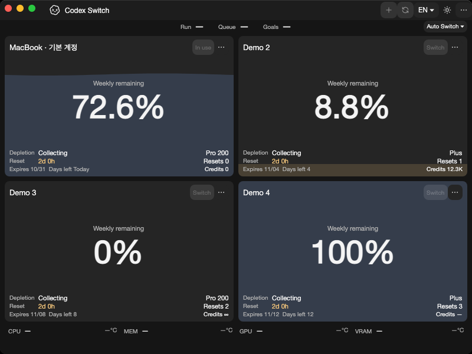

# Windows temporary cleanup after cancelled sign-in

Issue139 / PR140, source `6b2f9752646db73476588bd859fbb858e01d719f`, version1.43.2 and reviewed application runtime10.0.13.

A Windows file may stay briefly locked after an owned query ends. RuntimeHome now waits asynchronously only for sharing/lock errors32/33, every50ms for up to2seconds. Every attempt invokes the same secure root/GUID/link validation. Immediate cleanup stays immediate; persistent locks and nonsharing permission errors still surface. There is no force-closing of processes/foreign handles or widening of permissions.

## Actual native application before/after

| Native Windows1.43.1 baseline | Native Windows1.43.2 |
| --- | --- |
|  |  |

The application layout is unchanged, apart from the version. These original own-window frames confirm UI continuity; they do **not** visually reproduce or prove a real owner's cancelled login. The baseline is source631fc5900f911bf1aae11cb51168095e060a1a0f; current frames come from the exact capture source above. All profiles are fictional.

| Native Mac ARM64 | Native Mac Intel |
| --- | --- |
|  |  |

All four originals were visually inspected and copied without changing pixels. The three current native UI sets contain72 declared frames; metadata, dimensions, every image hash and GitHub artifact archive SHA256/size were verified. Mac renders are hosted native windows with software rendering, not a physical MacBook acceptance.

## Independent native behavior regression

`tests/account-automation/RuntimeCleanupContracts.cs` uses an actual Windows exclusive `FileStream` on a synthetic goals-style file inside a private disposable production RuntimeHome. No account secret, real browser or Codex process is involved.

- The original implementation fails the deterministic asynchronous-wait/cancellation contract.
- The corrected Windows account/history/recovery suite passes220 checks: ordinary/idempotent cleanup, nonblocking wait, original cancellation token preservation after release, bounded persistent-lock refusal and unsuppressed nonsharing permission failure.
- Existing secure deletion and all prior account/history/recovery assertions remain unchanged. Unix unlink behavior is separate; non-Windows sharing acceptance and execution of the standalone non-Windows suite are not claimed here.

[Exact native receipts, artifact/selected image hashes and canonical implementation bindings](evidence.json). [Capture Verify](https://github.com/Gaebabi/codex-switch/actions/runs/41105600090) / [capture Linux](https://github.com/Gaebabi/codex-switch/actions/runs/41105600066). Receipt/export success is distinct from overall capture-run completion; final-head six protected jobs and inspected complete packages remain required before author self-review, expected-head merge and verified public downloads.

No owner installation, real account switch/login, billing action, live Codex shutdown or Continue. Existing local provider/history experiments and their accounts/settings are outside this delivery. Windows/Linux unsigned, Mac ad-hoc/unnotarized and incomplete Linux desktop support remain separate limits.
