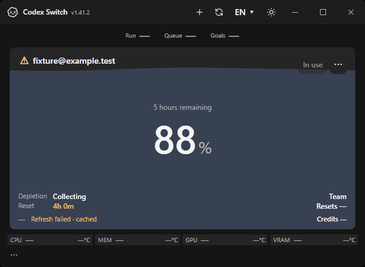
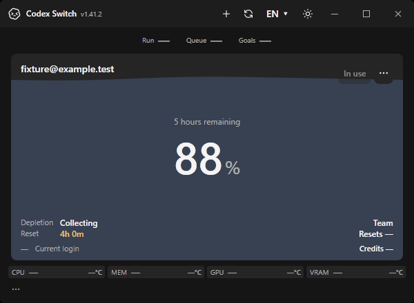
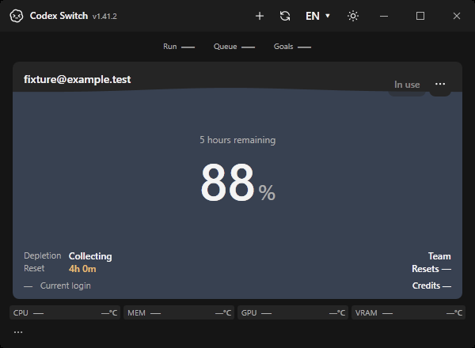

# Windows runtime-update recovery

This directory preserves the original community PR107 evidence at commit `6c137e1e339b03b6a7849695475c2c614680ca82`; its verification hashes refer to that historical source. [Issue113](https://github.com/Gaebabi/codex-switch/issues/113) integrates it with1.42.3. The current implementation retains valid cached files and serializes discovery only after an executable disappears; the gap fixture now removes the actual replacement executable. New hosted verification compares current main1.42.2 with1.42.3 and exports `runtime-recovery-windows`. Native mode now refuses non-hosted runs to preserve owner input isolation.

These are actual Windows x64 WPF application windows captured from their own HWND with the production capture helper. All account data is fictional, the canonical authentication file belongs to a disposable test directory, and the CLI is an offline JSON-RPC fixture. No personal screenshot, login, home path or installed Codex process is used.

| Before: refresh after the old CLI is removed | After: same-window refresh uses the replacement CLI |
| --- | --- |
|  |  |



The baseline is unmodified main `2779bfc135e4b3a2c9b7ab1141938c0605ac8e2c` with the same verification harness. The corrected case adds only the Windows rediscovery block in `AccountService.OpenAccountRpcAsync`; the titlebar/version/layout are the current main application. Both sides are 600 by 440 native pixels on the same Windows worker. No UI pixels are composed or redrawn.

The service regression first succeeds, removes the old executable, selects the replacement while retaining the same service, verifies a fresh usage observation/new path, then exercises an explicit installation gap and later recovery. It also checks cancellation and unchanged canonical fixture authentication bytes: eight checks.

The native harness exercises the ordinary Refresh button and the existing DispatcherTimer callback, retains the same HWND/service and confirms unchanged fixture credentials: six corrected checks. Only the test timer interval is shortened from 60 seconds to 100 milliseconds; production timing is unchanged. The baseline expects the original failure and passes four checks documenting it.

Commands:

```text
dotnet run --project tests/runtime-recovery/RuntimeRecovery.Tests.csproj -c Release --no-launch-profile -p:UseSharedCompilation=false
dotnet run --project tests/runtime-recovery/RuntimeRecovery.Tests.csproj -c Release --no-launch-profile -p:UseSharedCompilation=false -- --evidence artifacts/runtime-recovery/after
```

To reproduce the baseline, run the identical test harness against the unmodified main application sources with `-- --evidence artifacts/runtime-recovery/before --baseline`.

This verifies Windows service/button/timer recovery across local executable removal and replacement. It does not certify a Microsoft Store update, real account token refresh, account switching/resumption, Mac/Linux behavior or hosted CI. An unavailable installation still produces an explicit error and retains cached usage; recovery happens on a subsequent refresh, not with a zero-interruption guarantee.
