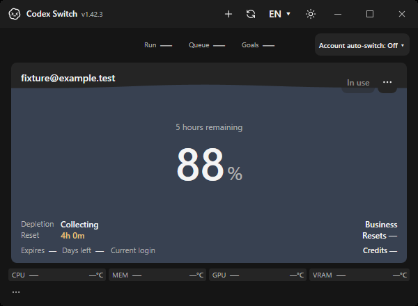
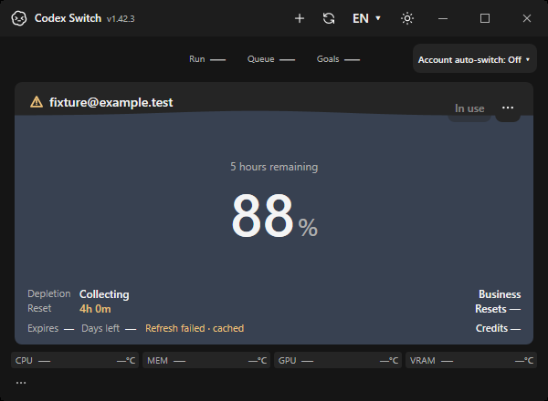
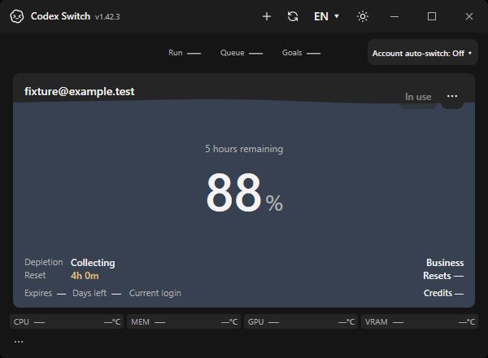

# Windows runtime recovery1.42.3

These are actual own-window HWND captures on disposable hosted Windows CI, using fictional accounts and offline RPC executables. The same harness reproduces the missing-path failure against unchanged main1.42.2 (`dd7fe742d01a15740784c13c953165b8f2999137`) and verifies1.42.3. [Source, checks and image hashes](verification.json).

| Unchanged1.42.2 after cached executable removal |1.42.3 manual Refresh, same HWND/service |
| --- | --- |
|  |  |

Nine service checks cover valid-path caching, replacement/new usage, real missing-file gap/recovery, unchanged fixture authentication and cancellation. Native baseline4/fixed6 checks exercise the ordinary Refresh button and production timer callback; the test timer alone is shortened to100ms. The renderer waits for the account-card state and WPF paint before original PrintWindow capture. All four600×440 images were individually inspected, private metadata removed and original pixels preserved. The baseline production files are hash-checked unchanged; diagnostic hosting is copied separately.

This does not certify a live Microsoft Store update, authenticated token refresh, real account switching/active-chat continuation or Mac/Linux behavior. No owner account, Codex installation, screen/input or hardware observation was used. [Original contributor evidence](../README.md) retains its historical1.41.2 scope. [Delivery gates](../../../development/RELEASE_1_42_3.md).
