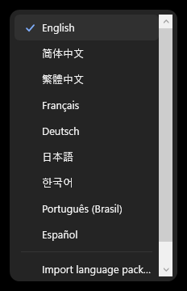
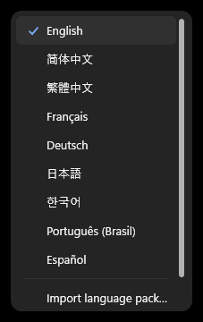
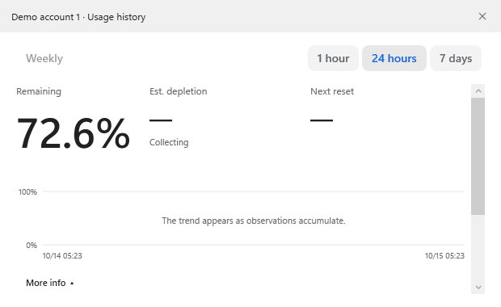
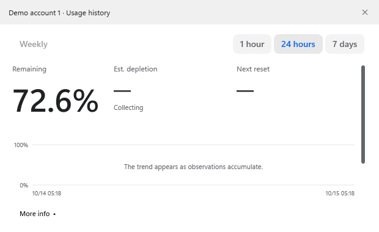
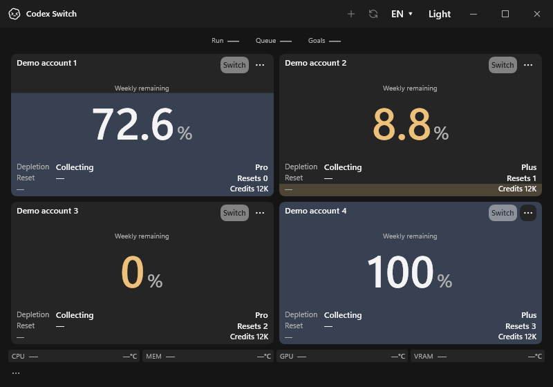
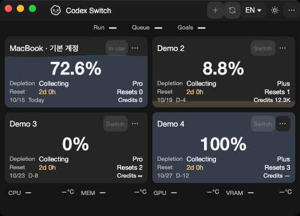
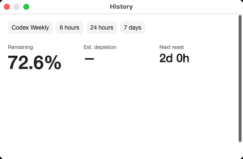

# Shared scrollbar and theme action evidence

Tracks [issue31](https://github.com/Gaebabi/codex-switch/issues/31) and [PR32](https://github.com/Gaebabi/codex-switch/pull/32). Actual app-owned native windows/popups, fictional accounts only. All56 lossless PNGs have metadata stripped and source/runtime/architecture/dimension/SHA256 receipts. No private screen, user identity, credential or raw diagnostic is published.

| Windows language before | Windows language after |
| --- | --- |
|  |  |

| Expanded history before | Expanded history after |
| --- | --- |
|  |  |

| Text theme action before | Vector theme action after |
| --- | --- |
|  |  |

| Native Mac Apple Silicon menu | Native Mac Intel minimum window |
| --- | --- |
|  |  |

The rounded6px thumb has a12px hit track, transparent background, theme-aware normal/hover/drag colors and native page/drag behavior. Both orientations share the same theme boundary. Windows installs it in window/pop-up resource dictionaries; Mac installs it in window/pop-up control themes. History, drive dialogs, account overflow and future scroll viewers inherit it. Mac's default menu used arrow scrolling rather than a scrollbar, so the shared menu template now uses an ordinary scroll viewer and retains its items presenter.

Sun in dark mode selects light; moon in light mode selects dark. Glyphs are vectors, and existing translated Light/Dark tooltip/accessible names and saved-theme callbacks are preserved. Mac history keeps a160px chart minimum and scrolls when compact content exceeds its viewport.

## Revisions and checks

- Windows before: source `1458fe0e6bbbc1fd3ac6a401defca98a0ad4a8ce`, app1.30.1. An isolated source archive adds capture-only diagnostics and a nonvisual language-button name; original UI/style logic is unchanged. The same fictional profiles, own-HWND captures and diagnostic software renderer are used before/after. It does not modify the installed app or real home/vault.
- Windows after: source `a40855486ba918c015fc9724e57e093a5c27dd56`, app1.30.2. [Before receipt](windows-before/evidence.json), [after receipt](windows-after/evidence.json). All12 images on each side use the same local native host; they are not mixed local-versus-CI comparisons.
- Mac after: source `a0f875b1647811c1b13371a575106ca0385f21b4`, app1.30.2 on native macOS15 arm64/Intel. [Apple Silicon receipt](mac-arm64/evidence.json), [Intel receipt](mac-intel/evidence.json). Each architecture has16 app/menu/history captures. Earlier native Mac text-action screenshots remain in [the previous checkpoint](../shared-core/README.md); no pre-change Mac menu/history screenshot is claimed.
- [Run38631880233](https://github.com/Gaebabi/codex-switch/actions/runs/38631880233) passes all four jobs: Windows93 internal/SQLite23/native handoff5, core/language41(native)/42(Ubuntu), temperature29, Mac SQLite23 and21 UI/menu/history cases. Both menus and histories have real overflow and their offsets change; Mac additionally asserts the language scrollbar is visible. All main-window size/language/theme checks remain intact.
- Evidence modes use software rendering on Windows/Mac for native own-window capture. Production rendering selection is unchanged. Uniform-color captures are rejected; they are not published as success. Popup capture remains constrained to the app's own HWND/PID or native top-level handle, with no desktop fallback.

This verifies UI appearance, native bootstrap and synthetic scroll interaction. Real-account switching, personal sensors, Keychain/signing/install acceptance and a binary Release are separate; published downloads remain1.27.6. PR32 records the final complete-head CI, author self-review and authorized merge.
