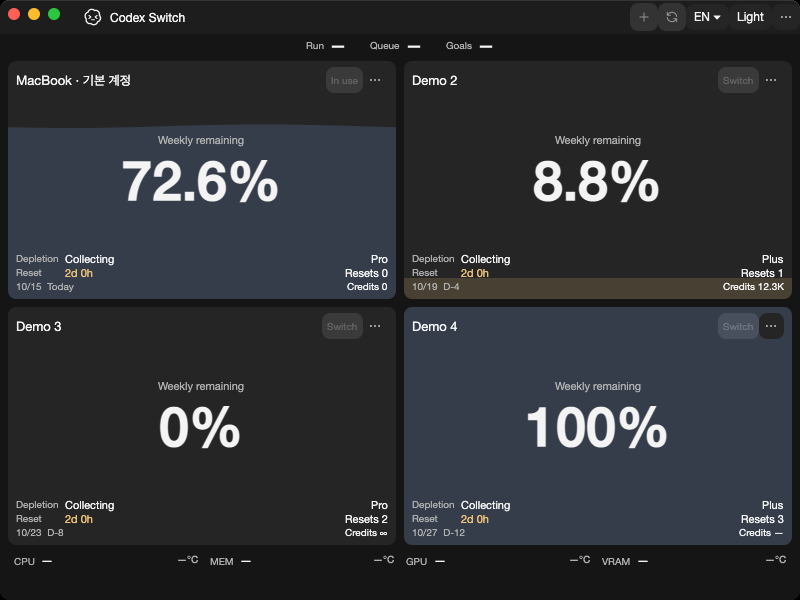
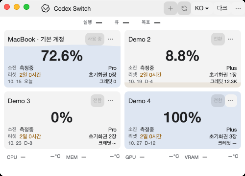

# Native shared-core extraction evidence

Tracks the first focused part of [issue3](https://github.com/Gaebabi/codex-switch/issues/3), [PR28](https://github.com/Gaebabi/codex-switch/pull/28). Actual self-contained apps run on Windows x64, macOS15 Apple Silicon and macOS15 Intel. All profiles are fictional; only the app's own HWND/NSWindow is captured, with PNG metadata removed. No private desktop, account, home directory, chat or raw diagnostic is published.

| Windows before, app1.30.0 | Windows after, app1.30.1 |
| --- | --- |
|  |  |

All eight Windows English/Korean, dark/light,800×560/500×360 native PNGs are byte-identical before/after extraction. This comparison uses hosted Windows captures for both sides, not local-versus-hosted images.

| Mac Apple Silicon before | Mac Apple Silicon after |
| --- | --- |
|  |  |

| Mac Intel before | Mac Intel after |
| --- | --- |
|  |  |

Mac geometry/no-clipping/no-scroll/menu/count assertions remain unchanged and pass on both native architectures. Water animation and native focus can differ between frames; Mac images are not claimed byte-identical. Mac diagnostic software rendering does not prove Metal or physical sensors.

| Minimum Windows500×360 | Minimum Mac500×360 |
| --- | --- |
|  |  |

## Source and verification

- Before: app1.30.0/.NET10.0.13, source `07efba62066b123ac0ed39f43879130e85bc9858`, [native baseline run38622544372](https://github.com/Gaebabi/codex-switch/actions/runs/38622544372); [baseline receipts/scope](../platform-runtime/README.md).
- After: app1.30.1/.NET10.0.13, source `9433b79faef0f69e26c8725eb162559f275f6dca`, [all four jobs passed in run38626725906](https://github.com/Gaebabi/codex-switch/actions/runs/38626725906). [Windows manifest](windows/evidence.json), [Apple Silicon manifest](mac-arm64/evidence.json), [Intel manifest](mac-intel/evidence.json) retain exact revision/runtime/architecture and all32 image SHA256/dimensions.
- Windows internal93, read-only SQLite/WAL23 and native normal-shutdown/coordinator5 pass. Both Mac architectures pass SQLite/WAL23 and19 strict UI/menu/count cases. Core/language contracts41 pass on Windows/Mac; Ubuntu adds one unsupported-platform vault/discovery contract (42). Temperature contracts29 pass on all hosts.
- One core assembly owns domain/refresh/checkpoint/catalogue/resource policy without WPF/Avalonia/P/Invoke dependencies. Platform write refusal preserves installed pack bytes, current selection and in-memory translations. Catalogue resources are loaded from that assembly. Existing vault/key/data/bundle/IPC identities and Windows/Mac defaults are unchanged.
- Managed version1.30.1 is shared in `Directory.Build.props` and checked against Mac bundle metadata. Package inspection requires every declared project runtime DLL, including `CodexSwitch.Core.dll`; a disposable missing-core package is rejected without executing a binary.
- Initial Intel captures failed at the first window with an unavailable WindowServer image. Evidence mode now activates only its own window, checks AppKit native visibility with a bounded deadline and displays pending views before one OS capture. The successful run uses this preparation; no screen fallback, capture retry or softened UI assertion. Failure stderr remains private.

Latest-head CI/review/merge is recorded by PR28. This is partial issue3 completion: key provider, discovery/lifecycle, authenticated IPC, SQLite and hardware provider projects remain follow-ups. It provides no Linux executable, Keychain acceptance, real-account switch/resume, signing/install acceptance or new binary Release. Public downloads remain1.27.6. Historical text privacy remediation is separately tracked in [issue29](https://github.com/Gaebabi/codex-switch/issues/29).
