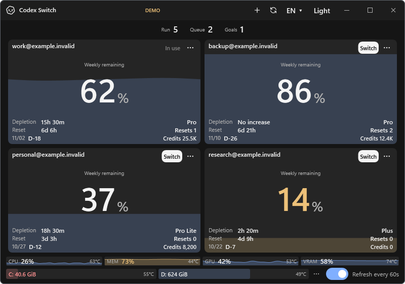
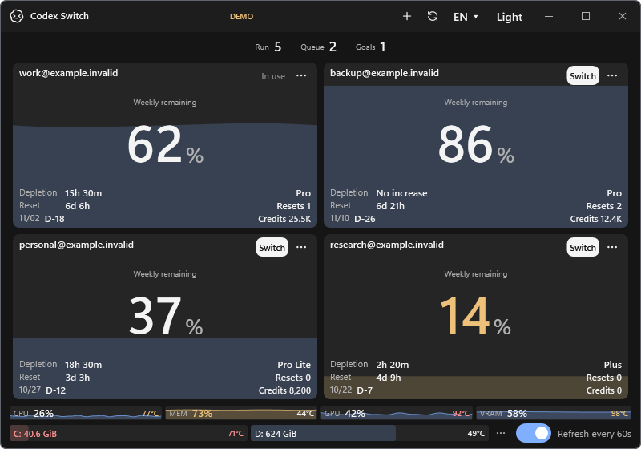

# Single-click handoff evidence

Related [issue #21](https://github.com/Gaebabi/codex-switch/issues/21). The reported extra click occurs after Windows normal shutdown: the old implementation checked process presence immediately after Restart Manager returned. A same-executable child can still be cleaning up, so the coordinator stops before account application. The second click finds the processes gone and continues the saved plan.

Using the production shutdown code with a disposable GUI parent and a child that exits 1.8 seconds after its parent, the old version failed after approximately 115 ms with the parent exited and child still running; a second invocation later succeeded. The corrected version completed its first invocation after approximately 1.9 seconds, with both processes gone. These are isolated process observations, not live Codex/account/chat acceptance. The owner's earlier failed receipt was overwritten by their successful second invocation, so this reproduction does not establish that receipt's precise error.

| Before: source 1.29.0 application | After: source 1.29.1 application |
| --- | --- |
|  |  |

The actual WPF application components retain their UI. This comparison confirms the program's visual layout; it does not show an actual account handoff. Account/session/sensor inputs are fictional. No private source pixels, recoverable blur or personal metadata are present. Native lifecycle checks exercise the production shutdown and coordinator with only disposable fixture processes; credential application, launch and chat resume endpoints in that fixture are synthetic and counted once.

Windows CI tests absence, delayed children, cancellation, the 30-second deadline and native shutdown refusal. Production does not force-kill the desktop or ignore Restart Manager errors. Ambiguous Continue delivery and account identity checks are unchanged. Mac already waits for native termination; this correction changes the Windows lifecycle boundary.

Primary Windows API reference: [Restart Manager shutdown and error semantics](https://learn.microsoft.com/en-us/windows/win32/api/restartmanager/nf-restartmanager-rmshutdown).
