# Auto Switch and bounded retry verification

[Issue117](https://github.com/Gaebabi/codex-switch/issues/117) / [Issue119](https://github.com/Gaebabi/codex-switch/issues/119) / [PR118](https://github.com/Gaebabi/codex-switch/pull/118) / [behavior and delivery](../../development/RELEASE_1_42_5.md) / [source/image hashes](evidence.json).

Original export bytes are unchanged and metadata-free. Windows own-HWND windows/popups use fictional accounts and an offline lifecycle backend. The retry fixture sets busy context and calls production coordinator/WPF progress/save callbacks; it does not click a real Switch button, start/stop a personal client or establish authenticated switching/Continue. Baseline production1.42.4 is unchanged. Capture source 4da56af7d506aea37a34a02bbae430a5fee039d6, workflow 40377891971, is distinct from later evidence/final release commits; source hashes bind unchanged implementation.

## Actual application before and after

|1.42.4: transient launch returns to Recover|1.42.5: same invocation completes after two retries|
|---|---|
|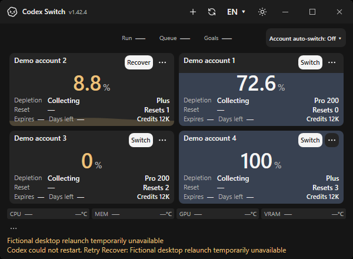|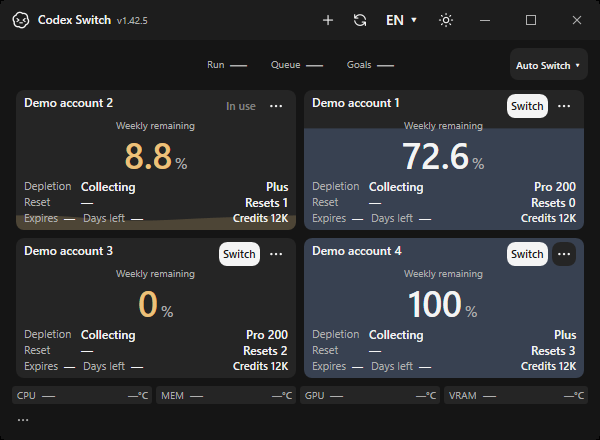|
|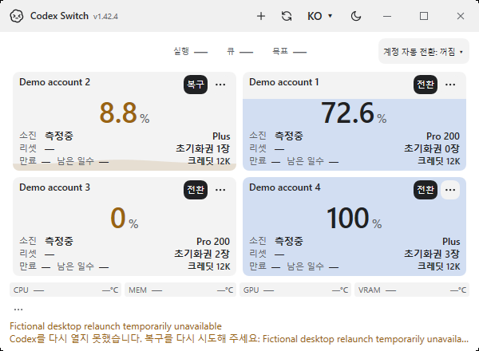|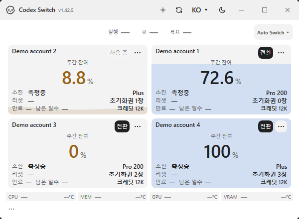|

|First retry stays busy|Second retry stays busy|Exhaustion retains manual Recover|
|---|---|---|
|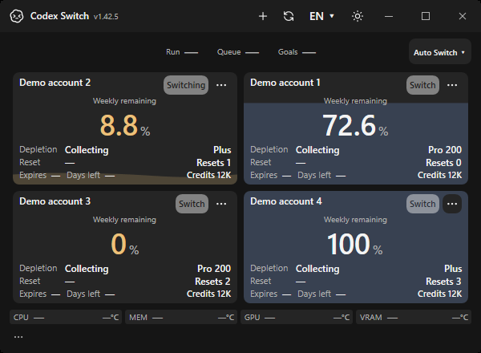||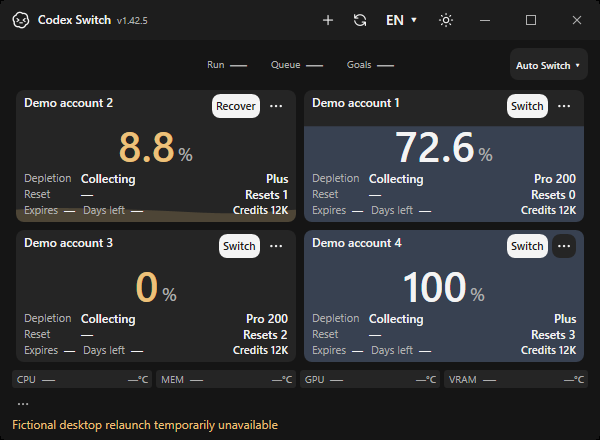|
||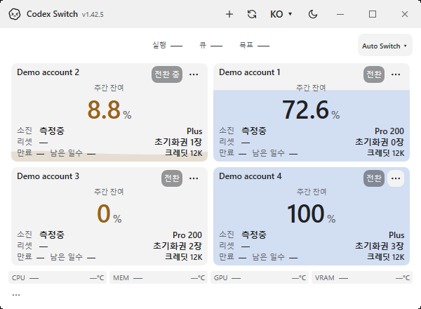|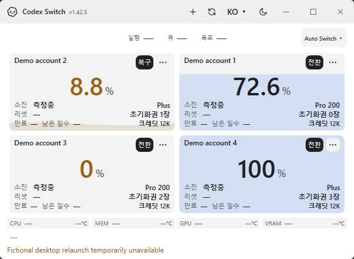|

Twelve baseline and30 current native assertions verify actual visible/enabled controls, same-window lifetime, persisted retry reservations, one backup/shutdown/account application, one stable Continue identity, completed checkpoint clearing and manual recovery after exhaustion. Lifecycle endpoints are offline fixtures. One real Application runs per process, retaining the production ExitAsync behavior; newly rendered controls are arranged before native-template inspection. Failed preliminary fixture iterations are not accepted as passing evidence.

## Auto Switch toggle and next account

|Off with next-account forecast|On with persisted toggle|
|---|---|
|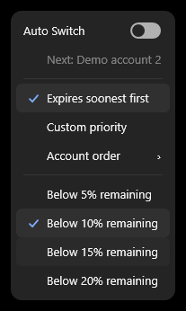||
|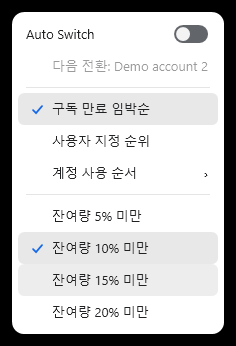|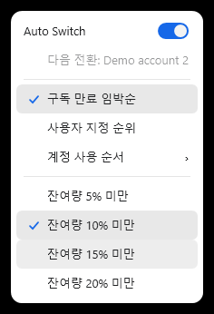|

The existing28 account/UI assertions are retained with the requested Auto Switch title and accessible On/Off state. Eight additional actual popup assertions check the visible track/thumb, persistent On state, next target before low quota and preference for nearer expiry over higher remaining quota. Policy/contracts115 cover eligibility, custom ranks, dates, read-only forecasts, durable/cross-stage budgets, cancellation/refusal and ambiguous-send observation. No additional poller, service or dependency is introduced. Shared Mac/Linux native title/geometry and builds have their own CI evidence; these popup images establish Windows menu execution.

Final source promotion requires six protected checks, author COMMENT self-review (not independent approval), expected-head merge/tree equality and verified package publication/anonymous downloads. The public Release and verification manifest are the publication receipt. Owner installation/accounts/live Codex/input remain separate and preserved.
