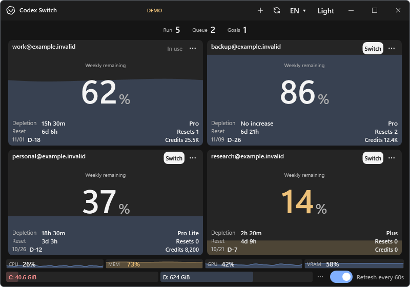
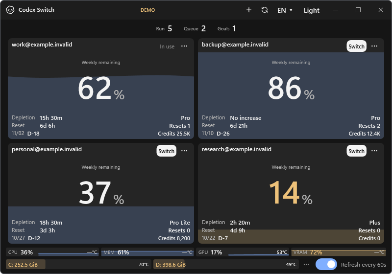

# Temperature application evidence

Related [issue #18](https://github.com/Gaebabi/codex-switch/issues/18). Lossless screenshots render actual Windows WPF application components at native size. All account/session inputs are fictional; no private identity/chat/token/home-path pixels enter the image, so no recoverable original lies beneath blur. These are not real-account switch/resume evidence.

| Before: 1.28.0 resource/free-space gauges | After: 1.29.0 sensor-capable UI fixture |
| --- | --- |
|  |  |

The after image uses fictional temperatures to verify separate right alignment and normal/yellow/red temperature colors on all six gauges. Temperature colors are independent of utilization/free-space colors. Minimum-size confirmation: [Korean 500×360](app-compact-ko.png).

This confirmation uses the production sampler to read Windows hardware/disk counters and sensors. CPU/RAM have no compatible provider here and VRAM is unsupported, so they show `—°C`; GPU and mapped disks show actual values. The host process was not elevated. Resource values are real; account balances/identities and session counts are fictional. No native Codex process was started, switched or interrupted.

Capture-only off-screen WPF rendering permits a disconnected display session and rejects empty output or resource text that does not fit. JSON provenance/layout receipts remain private. [Availability and collection](../../TEMPERATURES.md). Mac compilation/portable tests do not establish native Mac GUI/sensor acceptance.
