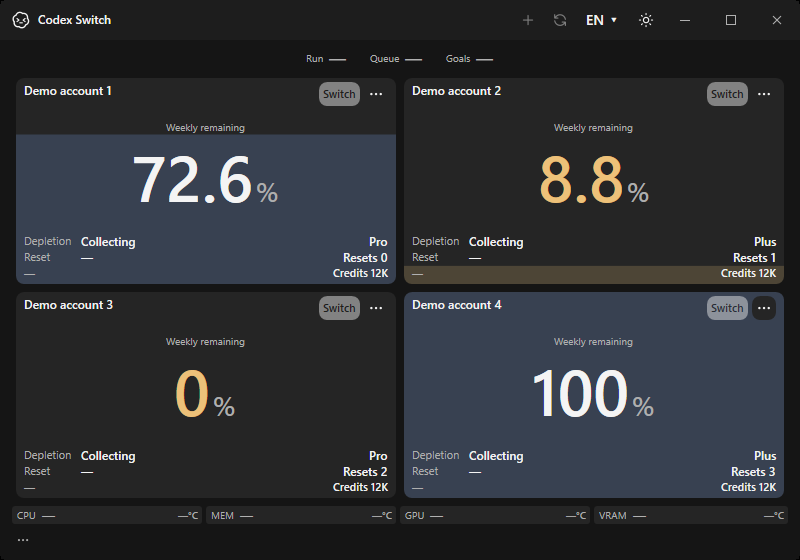
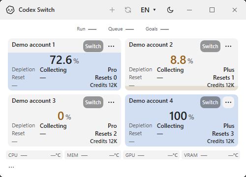
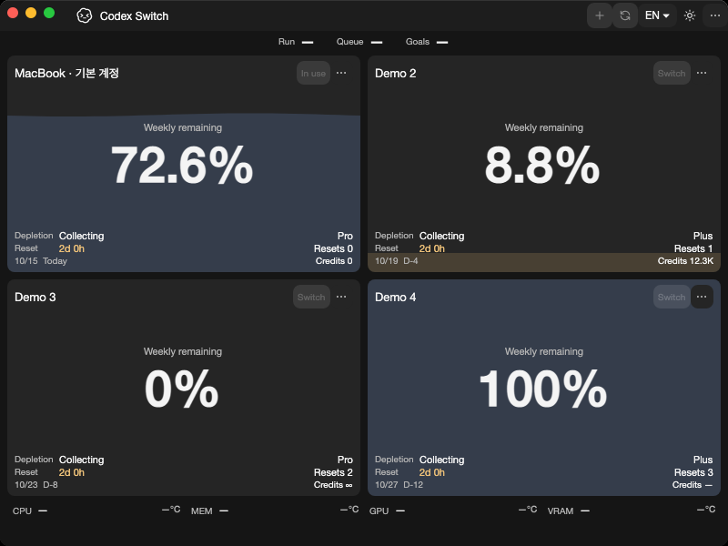
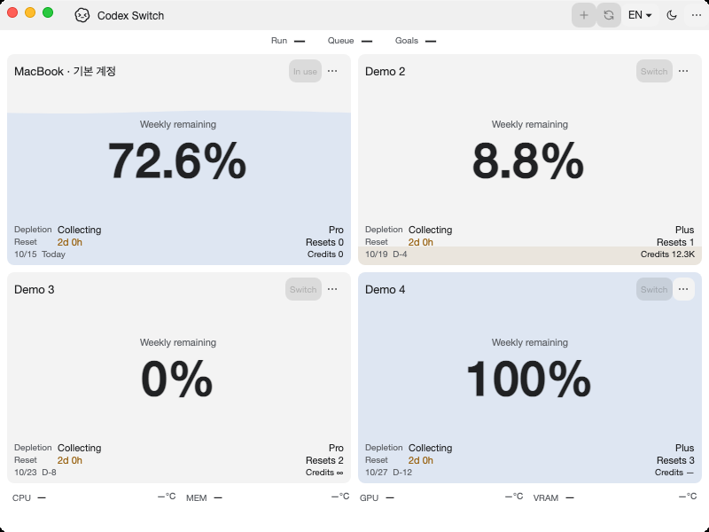
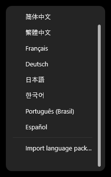
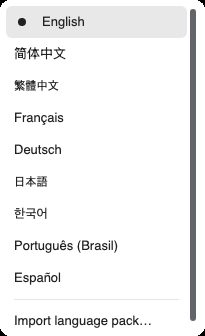

# Documentation screenshot

`demo.png` is the shared English/Korean/Japanese/Chinese README illustration: one 800×560 lossless PNG, rendered from source 1.30.2 Windows UI by `python scripts/render-demo.py`. It shows the vector theme action and always-on refresh layout. Published download packages remain 1.27.6.

The visible **DEMO** label and reserved `example.invalid` addresses identify fictional everyday data.

- Four distinct balances: work 62%, backup 86%, personal 37%, research 14%.
- Ordinary activity: 5 running chats, 2 queued messages and 1 goal.
- Resources: CPU 26%, MEM 73%, GPU 42%, VRAM 58%. Each graph fluctuates independently within a small bounded range over two minutes.
- Status colors come from the existing controls: normal blue, low quota/memory caution yellow, low drive free space red.
- The transparent outer corners use the window's 8px radius and a thin 1px gray edge.

Forecasts are calculated by the actual usage predictor from synthetic history. No real accounts, authentication, live tasks or native Codex process are used. Resource values are simulated rather than produced by stressing the machine.

`demo.json` records the scene, shared source version, exact revision, date, language/theme and PNG SHA256. The PNG has no private identities or image text/EXIF metadata. Re-render when the UI changes; this illustration is separate from account-switch, performance or Mac acceptance evidence.

## Native platform gallery

Fresh published-app own-window captures for Windows x64 and macOS15 Apple Silicon/Intel, source 1.30.2 / runtime .NET10.0.13. All four jobs in [capture run38633951637](https://github.com/Gaebabi/codex-switch/actions/runs/38633951637) pass at exact source `1a2cc586c15a0f772b2e96617fb2e2e1fe0e43e7`. The six selected lossless PNGs are inspected; [source/runtime/dimension/SHA256 receipts](native/gallery.json) contain no private diagnostics.

| Windows x64, dark | Windows minimum 500×360, light |
| --- | --- |
|  |  |

| macOS15 Apple Silicon, dark | macOS15 Intel, light |
| --- | --- |
|  |  |

| Windows language scrollbar | Mac language scrollbar |
| --- | --- |
|  |  |

This is a selected gallery, not duplicate full test output. Complete size/theme/language/menu/history sets are validated by CI before export. Evidence mode uses software rendering on Windows/Mac; production rendering selection is unchanged. The README illustration's [before/after comparison](../evidence/documentation-refresh/README.md) preserves the former image separately.

Only synthetic profiles and simulated resources enter evidence mode. No live Codex action, real account, private chat, personal desktop or home path is captured. Native app-window execution does not establish live switching, resume, physical sensors, signing, Keychain or Linux support.

Older GIF recordings remain historical and are not reintroduced.
