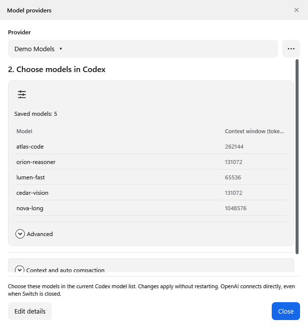

# Custom model screenshots

The full-size Windows images show the production Codex Switch controls with fictional providers and models. The native picker accepts enabled registrations on supported Windows Codex builds. [Desktop backend setup and compatibility](../../DESKTOP_MODEL_BACKEND.md).

[Dark theme](../release-1.45.5/models-en-dark.png) · [한국어](../release-1.45.5/models-ko-light.png) · [Capture details](../release-1.45.5/README.md)
