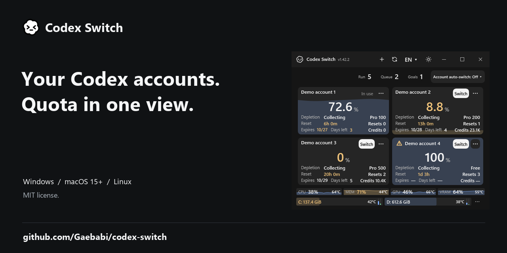

# Account and resource demo

These four images render the Windows UI from the public1.42.2 package with simulated accounts, quotas, session counters, CPU/memory/GPU/VRAM readings and two storage devices. They are **offscreen UI renders**, without a native window, personal account, Codex client, desktop input or hardware collection. [Application hash, runtime and image receipts](demo.json).

- [English dark](en-dark-demo.png) / [English light](en-light-demo.png)
- [Korean dark](ko-dark-demo.png) / [Korean light](ko-light-demo.png)

The demo shows CPU38%, memory71%, GPU46%, VRAM64%, simulated temperatures and history, and C:/D: free-space/I/O bars. These are illustrative inputs, not physical measurements or authenticated switching/continuation evidence. Original render pixels are preserved and PNG metadata is removed. The separate [native application evidence](../../evidence/account-automation/README.md) retains its own source and acceptance scope.

## Sharing image

[1280×640 PNG](social-preview.png) / [source and pixel-preservation receipt](social-preview.json). This graphic uses the English dark UI render above. Its availability in the repository does not establish that GitHub's separate Social preview setting has been applied.
