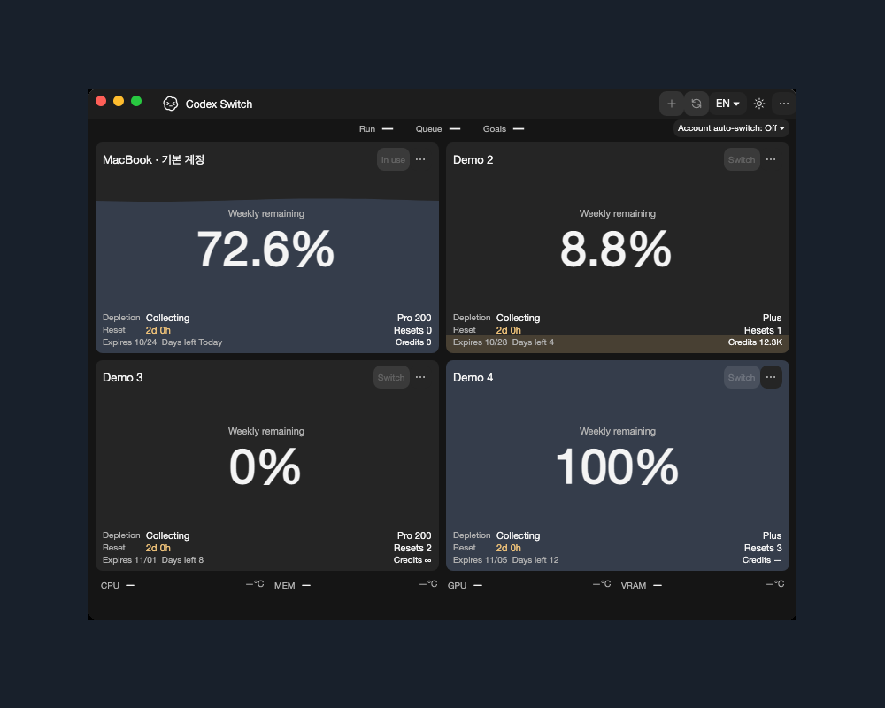
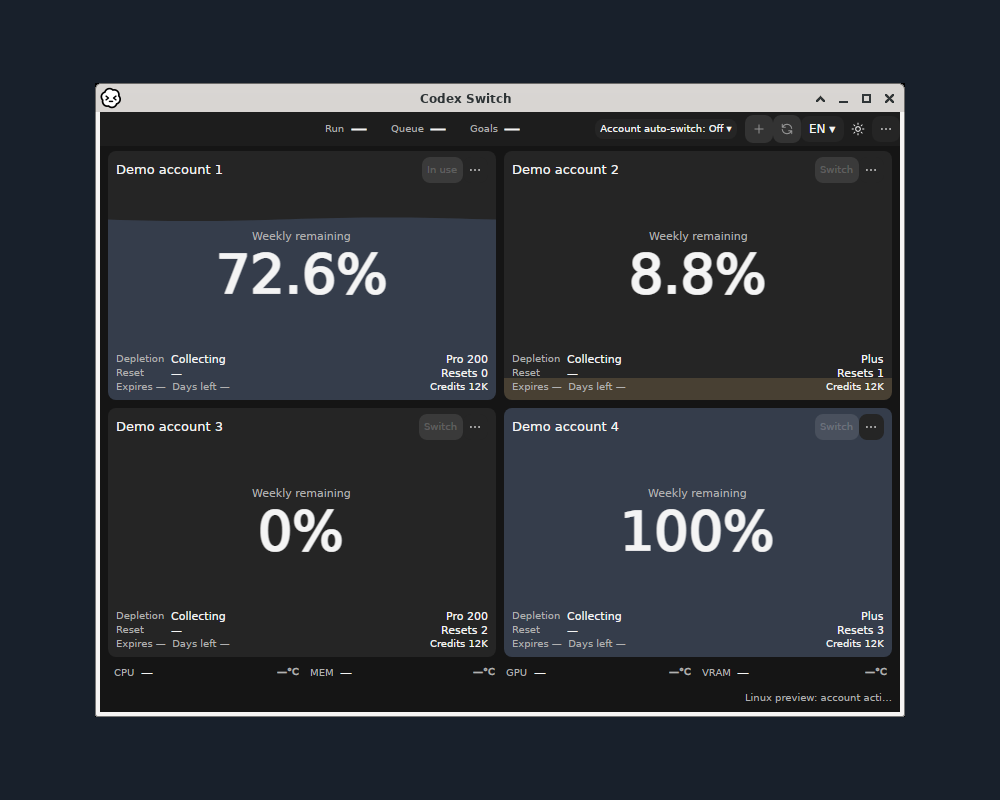

# Codex Switch1.42.2: native application confirmation

Actual native application windows with fictional accounts and isolated data, source `d1f483833b1c57aee6bbd923e7f5be3c9067039f`. [Original/output SHA256, dimensions, source and pixel-preservation receipts](gallery.json). Window pixels remain unchanged at1:1 on a solid background; no private screen, login or cursor is included. [Implementation/build-input tree](implementation-tree.json).

## Windows x64

Actual own WPF HWND: numbered Pro100/200/500 tiers, labeled subscription expiry/day values and explicit account-auto-switch wording. On is selected only inside the intercepted fictional evidence fixture; the product default is Off. [Light theme](windows-light.png). [Ten original native feature/menu images and28 assertions](../../evidence/account-automation/README.md) include Off, On, account priority, threshold persistence, displayed order and account-specific warning activation. No browser login, owner Codex shutdown or Continue occurs.

## macOS Apple Silicon and Intel

Native hosted macOS Apple Silicon app with fictional accounts; [Intel CI window](mac-osx-x64.png). These prove native layout and window capture. They are separate from a maintainer's MacBook/device capture and authenticated account switching.

## Linux x64 and ARM64

Native x64 X11/Xfwm4: four fictional account cards and the original direct-parent OS titlebar captured together. [Light theme](linux-x64-light.png).

Actual ARM64 runner, original app-PID/frame ownership and desktop-root exclusion. [Light theme](linux-arm64-light.png). No titlebar composition or personal login. Linux remains an integration preview with `supportedAccountHandoff:false`; booted GNOME/KDE/Wayland/accessibility and authenticated desktop handoff remain separate gates.

[Verify native capture run40086423732](https://github.com/Gaebabi/codex-switch/actions/runs/40086423732) / [Linux native run40086423631](https://github.com/Gaebabi/codex-switch/actions/runs/40086423631), source1.42.2/runtime10.0.13. Later documentation/evidence commits retain the captured implementation/build-input objects. The exact final merged package source, successful CI, hashes and review are recorded independently in the [public release verification manifest](https://github.com/Gaebabi/codex-switch/releases/download/v1.42.2/VERIFICATION.json).

## Maintainer MacBook image

Reserved for a privacy-reviewed actual maintainer MacBook image and provenance. Hosted native Mac CI captures above do not fill this separate slot.
<!-- MacBook screenshot slot: macbook.png; include original hash, source/version/runtime and privacy review. -->
