# Codex Switch 1.45.5 gallery

The README showcases six fictional accounts, five fictional custom models, a week of usage observations, resource trends and five tracked folders. No account, provider or filesystem inventory belongs to a real user.

## Windows showcase

These are **released Windows production controls rendered offscreen**, in English and Korean, with light/dark variants. They are not native OS-window captures, the actual Codex model picker, a live provider connection or a disk benchmark. The dashboard's DEMO marker and non-routable example provider identify the fixture.

| Models | History | Folders |
| --- | --- | --- |
| 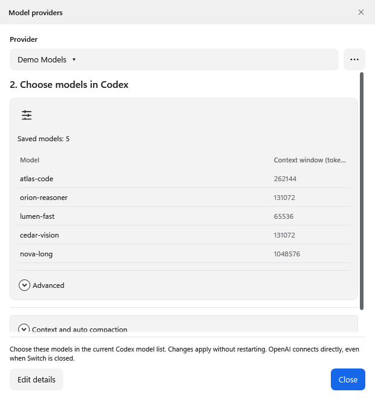 | 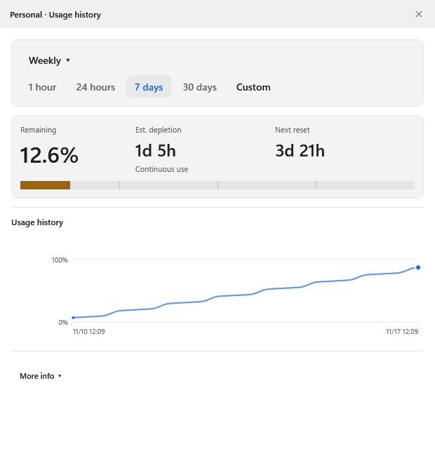 | 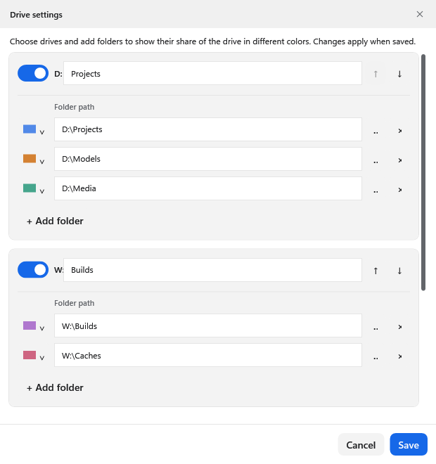 |

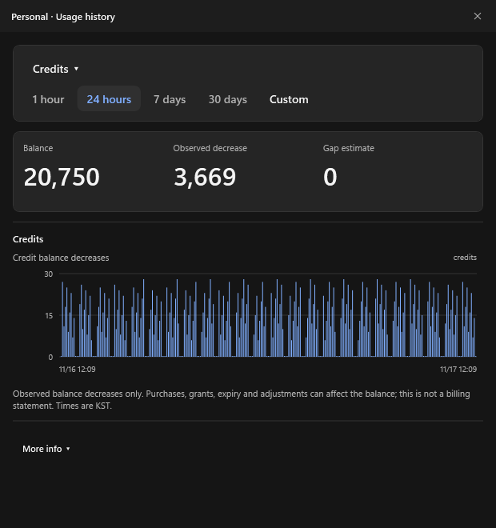

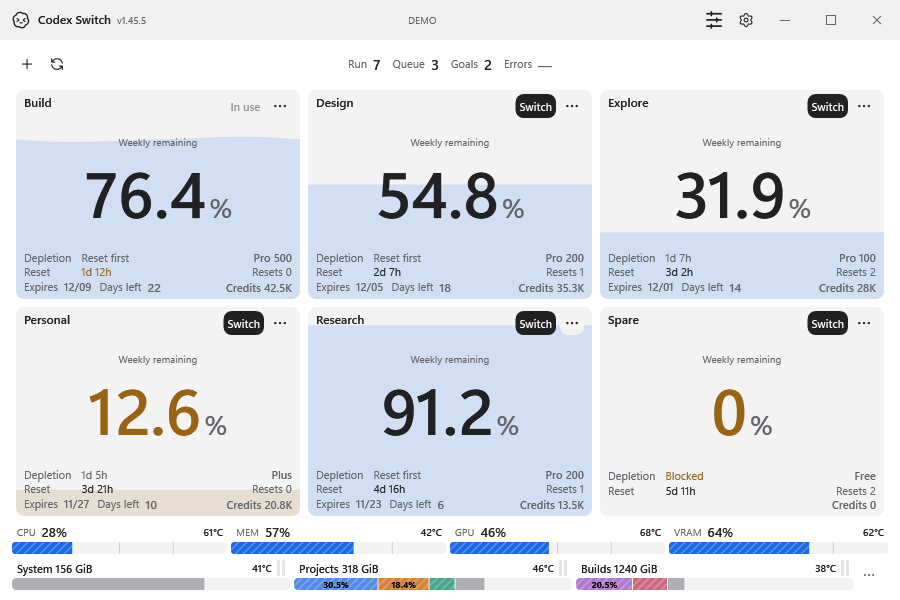

Dark theme and Korean UI

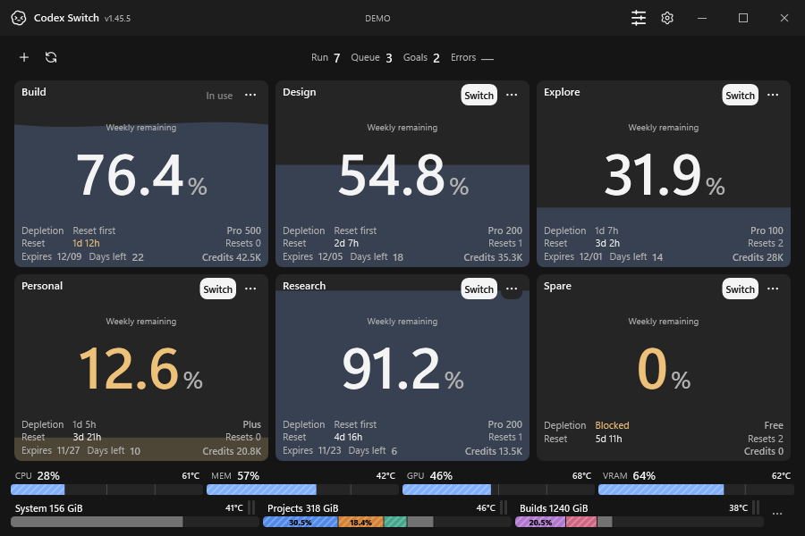
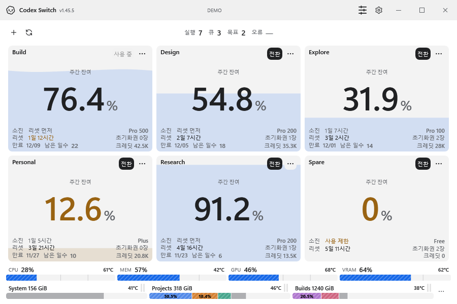
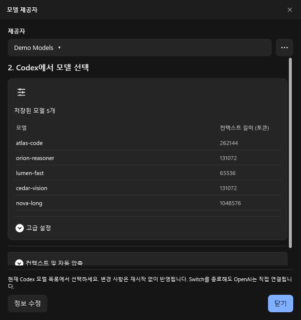

## Actual native windows

These unchanged images come from the final reviewed 1.45.5 CI head `8dc7342019c5fcb60f28a89f8b6272ef622ecc3d`. They use fictional accounts and preserve the actual application/OS titlebars. macOS is Apple Silicon on a hosted runner; this is not a personal MacBook capture. Linux x64 remains a preview.

| Windows x64 | macOS ARM64 | Linux x64 · X11 |
| --- | --- | --- |
| 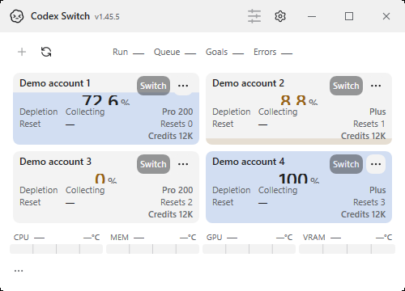 | 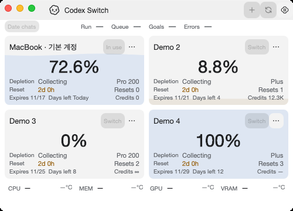 | 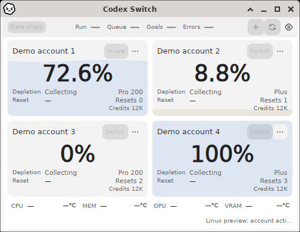 |

[Windows/Mac native CI](https://github.com/Gaebabi/codex-switch/actions/runs/43991365315) · [Linux native CI](https://github.com/Gaebabi/codex-switch/actions/runs/43991365388) · [Public verification archive](https://github.com/Gaebabi/codex-switch/releases/download/v1.45.5/CodexSwitch-v1.45.5-verification.zip).

## Reproduce and verify

Build `tests/model-providers-ui/ModelProviders.Ui.Tests.csproj`, then run its executable with `--showcase <absolute private output directory>` on Windows. It renders without showing or activating windows, uses disposable local encrypted storage and never starts Codex or sends provider requests. Do not point it at owner storage. For release illustrations, verify and load the complete released production assemblies beside the harness before capture.

[evidence.json](evidence.json) records every exported image hash, original capture hashes, the capture-source hash and the eight verified production-module hashes. Metadata is removed without changing pixels. Rendering proves the UI illustration; [native integration contracts and compatibility](../../DESKTOP_MODEL_BACKEND.md) establish the separate runtime scope.
